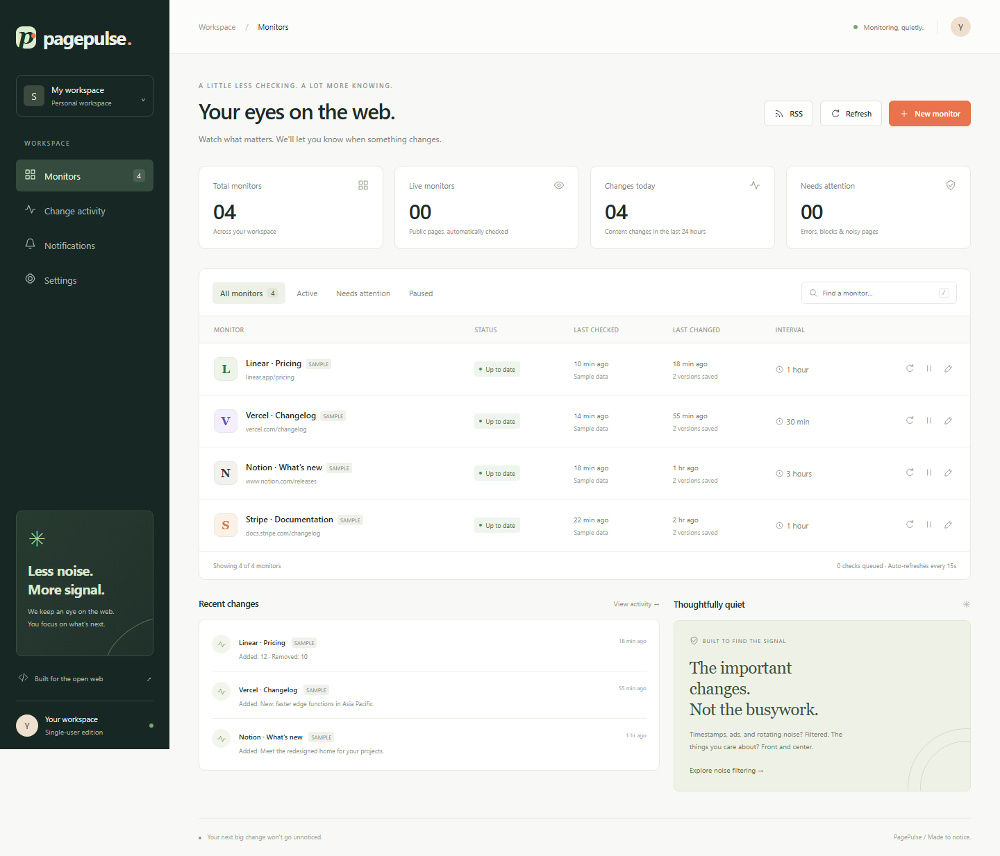

# PagePulse

**A little less checking. A lot more knowing.**

A runnable, single-user website change detector for public pages. Built with Node.js, Express, SQLite, Playwright/Chromium, and a dependency-free frontend. No paid service required.



## Quick start

Requires **Node.js 20 or newer** (Node 22 LTS recommended).

```bash
npm ci
npx playwright install chromium
cp .env.example .env          # Windows PowerShell: Copy-Item .env.example .env
npm run demo                  # optional: seed clearly-labeled sample monitors
npm start
```

Open **http://localhost:3000**. On Linux, if Chromium reports missing libraries:

```bash
npx playwright install --with-deps chromium
```

The server must remain running for scheduled checks.

### Try a real monitor

1. Click **New monitor** and enter a name and a public HTTP/HTTPS URL.
2. Choose an interval (15 min – 24 h) and a sensitivity level.
3. Optionally enter watch/ignore CSS selectors, or click **Select regions visually**.
4. Configure notification channels in `.env`, then enable them on the monitor.
5. Save. The first successful check creates a baseline.
6. After content changes, compare any two versions using **Text diff**, **Side by side**, or **Visual diff**.
7. Click **Number tracking** in the monitor detail to see charts of extracted numeric values over time.

The dashboard auto-refreshes every 15 seconds. **Check now** queues a job but does not bypass per-host cooldowns.

---

## Implemented features

### Core monitoring
- Public URL monitors with names, intervals, pause/resume, edit, and delete.
- Real JavaScript-rendered pages via fresh Playwright browser contexts — no stored logins or cookies.
- Persistent SQLite job queue, scheduler, bounded global concurrency, navigation timeouts, retries, per-host throttling, and failure backoff.
- Shared render per canonical URL: one browser fetch serves all monitors watching the same page.
- Normalized-text hashes; snapshots saved only on first baseline or a content change that passes the sensitivity threshold.

### Noise filtering
- Timestamp, relative-time, counter, UUID/hex-token normalization.
- Common ad/carousel element removal; explicit ignore-selector support.
- **High / Balanced / Low** sensitivity (any change / ≥0.5% / ≥3% text-change ratio).

### Visual region picker
- Screenshot overlay with element bounding boxes and stored CSS selectors.
- Click to add watch or ignore regions; chips shown in real time.

### Diff and comparison
- Word-level **text diff** with inline additions/deletions highlighted.
- **Side-by-side** screenshot comparison.
- **Visual diff** — pixel-level diff image with orange highlights.
- Select any two versions from the per-page timeline for comparison.

### AI-style change summaries
- Deterministic heuristic summaries that read like natural language: detects price changes, version bumps, status-word changes, additions, and removals.
- Stored per snapshot as `smart_summary`; shown with an **AI** badge in the comparison toolbar.

### Number tracking with charts
- Automatically extracts prices, metrics, and labelled numbers from page text after each check.
- Interactive line charts per label with change delta and data-point count.
- Accessible via the **Number tracking** tab in the monitor detail view.
- Backend: `number_snapshots` table + `/api/watches/:id/numbers` time-series API.

### Alerts and notifications
- Email (SMTP), Discord webhook, and Telegram bot — configure in `.env`.
- Rule-based deduplication: one immediate alert per monitor per hour.
- **Noisy-page guard**: after 3 consecutive changed checks, alerts suppress until an unchanged check resets the streak.
- **Keyword-only alerts**: comma-separated words matched against the change summary.
- **Optional daily digest**: batched events bundled into one message per channel.
- Persistent per-`(snapshot, channel)` outbox with retries and exponential back-off.

### RSS feeds
- **Per-monitor RSS**: `/api/watches/:id/rss` — subscribe any monitor to your RSS reader.
- **Global RSS**: `/api/rss` — all monitors in one feed.
- `<link rel="alternate">` autodiscovery tag in `<head>`.

### Browser extension
- Manifest v3 Chrome/Edge/Brave extension in `extension/`.
- One-click monitor creation from the current tab — no copy-paste needed.
- Configurable server URL (default: `http://localhost:3000`) stored in extension storage.
- See [`extension/README.md`](extension/README.md) for installation steps.

### Dashboard and history
- Stats: total monitors, live monitors, changes today, needs-attention count.
- Per-page version timeline (newest 300 versions).
- Global activity feed (25 most-recent changes).
- Notification delivery log with state, attempts, and error details.
- Statuses: `ok`, `pending`, `paused`, `error`, `blocked`, `noisy`.

---

## Notifications

Copy `.env.example` to `.env` and fill in any channels you want:

```dotenv
BASE_URL=http://localhost:3000
SMTP_HOST=smtp.example.com
SMTP_PORT=587
SMTP_SECURE=false
SMTP_USER=your-smtp-user
SMTP_PASS=your-smtp-password
MAIL_FROM=PagePulse <alerts@yourdomain.com>
MAIL_TO=you@example.com
DISCORD_WEBHOOK_URL=
TELEGRAM_BOT_TOKEN=
TELEGRAM_CHAT_ID=
DIGEST_HOUR_UTC=8
```

Restart after editing `.env`. The **Settings** page shows which channels are configured.

---

## The four design questions

### 1. Is an outage or CAPTCHA a content change?

No. Network failures, HTTP errors ≥ 400, and recognizable CAPTCHA/access challenges update the monitor status to `error` or `blocked` without replacing a snapshot or sending a change alert. The last good version is always preserved.

### 2. Do 200 users watching a URL cause 200 fetches?

Not in the shared-fetch model. One queue job per unique URL produces one browser navigation; all monitors sharing that URL share the captured DOM. Different URLs stay separate. (The app is single-user; multi-account auth is a future extension.)

### 3. How are endlessly-changing pages handled?

Normalized text, ignored regions, sensitivity thresholds, a one-hour notification cooldown, and an automatic **noisy-page guard** (3 consecutive changes → alerts suppressed) reduce alert storms. Versions continue being recorded. For highly dynamic pages, watch only a stable region via CSS selectors or the visual picker.

### 4. How do you avoid hammering a site?

A persistent per-host cooldown (default 60 s) between browser navigations; queue uniqueness coalesces checks; minimum interval is 15 minutes; global concurrency defaults to 2; retries use exponential back-off. **Check now** and the visual picker also honour cooldowns. This MVP does not automatically enforce `robots.txt` — respect the site's terms and rate limits.

---

## Architecture

```
Browser dashboard
       │ JSON /api
Express HTTP API ─────── SQLite (WAL)
       │                   ├── watches & shared targets
       │                   ├── durable jobs & host cooldowns
       │                   ├── snapshots (text + hashes + smart_summary)
       │                   ├── number_snapshots (label, value, created_at)
       │                   └── notification outbox
       │
3-second scheduler → bounded worker → Playwright public-page render
                                         │
                         per-monitor selectors + normalization
                                         │
                          hash / text-difference threshold
                                         │
                       smartSummary() + extractNumbers()
                                         │
                            changed? save PNG + snapshot
                                         │
                               notification outbox
                                         │
                               SMTP / Discord / Telegram
```

No Redis, no compilation step. SQLite is the durable queue and database. Run only **one app process per data directory**.

### Data model

| Table | Purpose |
|---|---|
| `targets` | Unique canonical URL, host, next due time, failure count |
| `watches` | Settings and status per monitor — selectors, sensitivity, channels |
| `jobs` | Persistent one-per-target queue with retry state and forced-check flag |
| `host_limits` | Persistent next-permitted navigation time per host |
| `snapshots` | Normalized text, hash, screenshot filename, summary, smart_summary, change % |
| `number_snapshots` | Extracted numeric values per snapshot for time-series charts |
| `alerts` | Unique `(snapshot_id, channel)` outbox records and delivery state |

### API overview

| Endpoint | Purpose |
|---|---|
| `GET /api/watches` | Dashboard monitors and statistics |
| `POST /api/watches` | Validate and create a monitor |
| `PUT /api/watches/:id` | Update settings (URL is immutable) |
| `DELETE /api/watches/:id` | Delete monitor, versions, and screenshots |
| `POST /api/watches/:id/pause` | Toggle pause |
| `POST /api/watches/:id/check` | Queue a shared browser check |
| `GET /api/watches/:id/versions` | Version history (newest 300) |
| `GET /api/watches/:id/numbers` | Number tracking time-series data |
| `GET /api/watches/:id/rss` | Per-monitor RSS 2.0 feed |
| `GET /api/rss` | Global RSS feed (all monitors) |
| `GET /api/compare?before=ID&after=ID` | Word-level text diff |
| `GET /api/visual-diff?before=ID&after=ID` | Highlighted PNG diff |
| `POST /api/picker` | Render a page and return screenshot + element boxes |
| `GET /api/activity` | Recent 25 snapshots |
| `GET /api/alerts` | Notification delivery status (newest 100) |
| `GET /api/config` | Channel availability (no secrets) |

---

## Tests

```bash
npm test
# With a running app (seed demo data first):
node scripts/smoke-ui.js
```

Automated tests (15) cover: normalization, price preservation, word-level diff, `smartSummary` price and content detection, `extractNumbers`, URL validation, private-network blocking, shared queue deduplication, snapshot persistence, unchanged suppression, error preservation, `smart_summary` storage, `number_snapshots` persistence, noisy-page recovery, and HTTP API behaviour (list, validate, pause, compare, CSRF, RSS, numbers).

The UI smoke script tests: dashboard load, form validation, version timeline, text diff, side-by-side and visual diff, number tracking tab, RSS link presence, edit modal, settings page sections (notifications, RSS, browser extension), notifications page, and mobile layout.

---

## Browser extension

Load the `extension/` folder as an unpacked extension in Chrome/Edge/Brave developer mode. See [`extension/README.md`](extension/README.md) for full instructions.

---

## Docker (optional)

```bash
cp .env.example .env   # edit BASE_URL and APP_PASSWORD
docker compose up --build -d
```

Open http://localhost:3000. The named volume persists your data. The image is large because it bundles Chromium.

---

## Security and limitations

- Intended for a **trusted single user**. Set `APP_PASSWORD`, use HTTPS, and restrict access before deploying.
- Public URL checks reject private/reserved addresses, credential-bearing URLs, non-HTTP schemes, and non-standard ports. Browser resource requests and redirects are also validated. WebSockets and service workers are blocked.
- Snapshots are **text-triggered** — visual-only layout or image changes do not create a new version. Screenshots capture the first 1440 × 1000 pixels.
- Rendering waits for DOM content plus 1.6 seconds. Page text is capped at 500,000 characters.
- `smart_summary` and number extraction use deterministic heuristics, not a cloud AI API. No page content is sent to any external service.
- Data is stored locally and unencrypted at rest. Never commit `.env`, `data/`, or screenshots to a public repository.

---

## Upload to GitHub

See **[GITHUB_UPLOAD.md](GITHUB_UPLOAD.md)** for terminal and browser-only instructions.

```bash
git init
git add .
git commit -m "Initial commit: PagePulse website change detector"
git branch -M main
git remote add origin https://github.com/YOUR_USERNAME/pagepulse.git
git push -u origin main
```

---

## Project layout

```
public/                  Dashboard HTML, CSS, JavaScript
extension/               Chrome/Edge/Brave browser extension (Manifest v3)
lib/browser.js           Public-page rendering and visual picker
lib/security.js          URL/IP validation
lib/detection.js         Normalization, hashing, text diff, smartSummary, extractNumbers
lib/db.js                SQLite schema (includes number_snapshots)
lib/worker.js            Scheduler, queue, snapshot saving, number tracking
lib/alerts.js            Alert outbox and provider delivery
scripts/seed-demo.js     Clearly labeled local sample data
scripts/smoke-ui.js      Browser smoke test (Playwright)
server.js                Express API, RSS feeds, lifecycle
test/core.test.js        Automated backend tests (15 tests)
```

Licensed under the MIT License.
